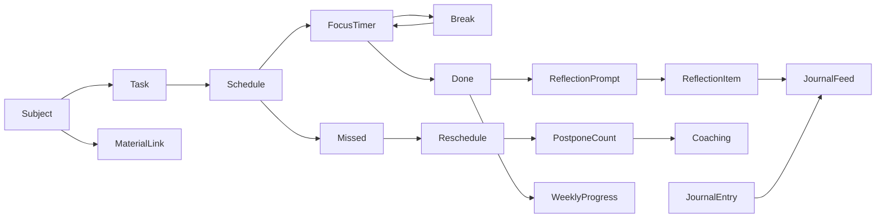
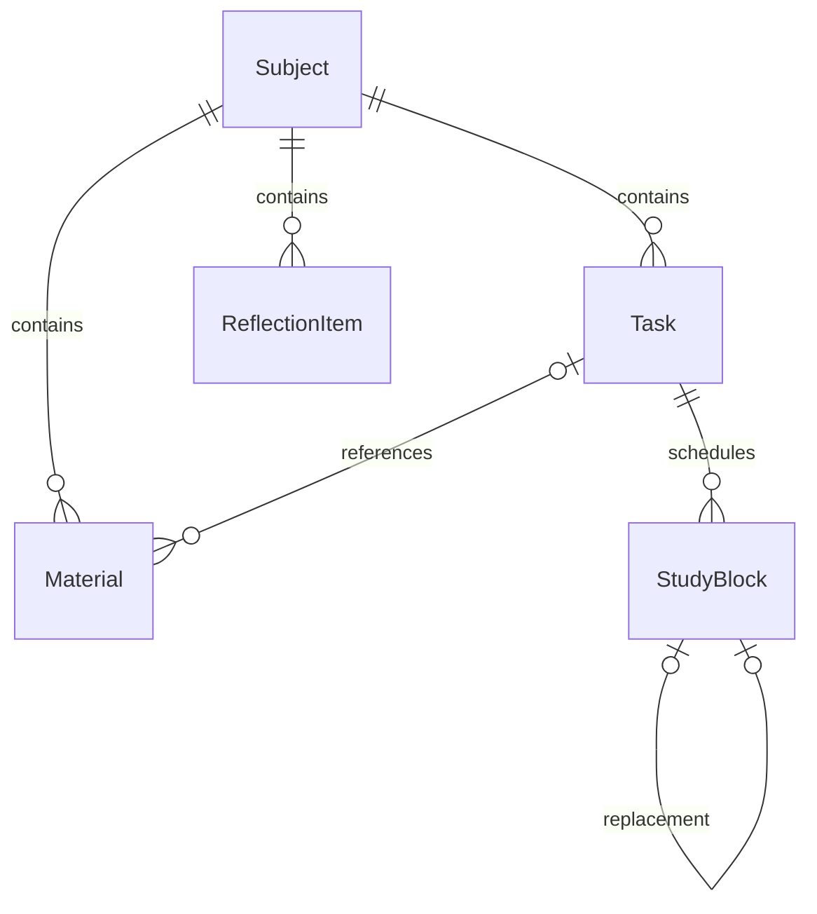

# Yotei project context

Current architecture updated: **2026-10-29, Asia/Singapore**. Original handoff snapshot: 2026-10-21. Source baseline: Git commit `edfb6ab` (`Fallback: Working state before fixing Expo Router entry point`). Read this file with [AGENTS.md](../AGENTS.md); inspect current code and `git status` before making changes.

## Purpose and implemented scope

Yotei is a mobile study planner. Its implemented academic loop is:



All study data remains in local SQLite. Appwrite is an authentication adapter; it does not currently synchronize subjects, tasks, study blocks, or reflection notes.

## Stack and package policy

- Expo `~57.0.31`, React Native `0.86.3`, React `19.2.3`.
- JavaScript implementation with JSDoc types and `checkJs`; thin Expo Router routes use TSX.
- npm and `package-lock.json`; no Bun lockfile at this snapshot.
- Expo Router supplies the root stack and JavaScript bottom tabs. Ionicons come from `@expo/vector-icons`.
- Native modules used include SQLite, SecureStore, FileSystem, Sharing, DocumentPicker, safe-area context, screens, system UI, and fonts. Router animation peers are pinned to SDK-compatible versions.
- Install or change dependencies with `npx expo install`, as specified in AGENTS.md.
- The development target is the native app. Browser support is not validated end to end.

## Routing and bootstrap

1. `package.json` retains `"main": "index.js"`.
2. `index.js` imports `react-native-url-polyfill/auto` first and then `expo-router/entry`.
3. `src/app/_layout.tsx` re-exports `App.js`.
4. `App.js` loads six local Merriweather/Inter font faces with expo-font before mounting SafeAreaProvider, ThemeProvider, TimeFormatProvider, SessionProvider, themed navigation and the protected root Stack. Font errors permit system fallback rather than blocking authentication.
5. Signed-out/restoring users see `src/app/sign-in.tsx` -> `screens/AuthScreen.js`.
6. Signed-in users see `src/app/(tabs)/_layout.tsx`, with a shared StudyWorkspace above Home, Library, Journal, and Settings (nested journal/ and library/ stacks).
7. Most tab routes re-export screens/. Library is a nested Stack under src/app/(tabs)/library/: index.tsx renders the shelf, [subjectId].tsx renders OpenedBookScreen. The former library.tsx wrapper was replaced; the shared workspace still wraps both views.

The original non-Router bootstrap used `registerRootComponent(App)`. That was superseded by the Router migration. Do not restore it while Router supplies the app entry.

### Additional root `app/` directory

At the start of this handoff, `app/index.tsx` was an untracked user file containing a Hello World screen. It is separate from the implemented app. The current export explicitly reports **Using src/app as the root directory for Expo Router**. Existing `tsconfig.json` includes `src/**/*.tsx`, but not the root `app/**/*.tsx` experiment.

The handoff preserves that file. If investigating a startup problem, verify the working directory, the entry chain, and Metro's selected root before moving/deleting routes or changing the architecture. A successful bundle verifies compilation, not a live navigation session on the phone.

References: [Expo custom entry setup](https://docs.expo.dev/router/installation/), [top-level src directory](https://docs.expo.dev/router/reference/src-directory/), [SDK 57 reference](https://docs.expo.dev/versions/v57.0.0/).

## File map

| Location | Responsibility |
| --- | --- |
| `App.js` | Bundled font loading, root providers, themed navigation, protected auth stack and web notice |
| `ThemeContext.js` | Shared palettes, AsyncStorage theme restoration/serialized saves, subject-color presentation, native appearance |
| `auth/AuthService.js` | Adapter interface and once-per-cold-boot remember-me gate |
| `auth/MockAuthService.js` | In-memory users, built-in demo account, SecureStore public session |
| `auth/AppwriteAuthService.js` | Appwrite email/password authentication and normalized users |
| `auth/index.js` | Active adapter switch and shared singleton |
| `auth/SessionContext.js` | Session restoration, sign-in acceptance, sign-out/name-update state and immediate normalized profile refresh |
| `TimeFormatContext.js` / `utils/timeFormat.js` | Saved device-wide 12/24-hour preference and shared clock/date-time formatting |
| `components/DisplayNameSheet.js` | Keyboard-aware profile-name editor with validation, loading and retained failure drafts |
| `screens/JournalEntryScreen.js` / `components/JournalEntryContent.js` | Dedicated full-page note reading/editing and confirmed deletion |
| `db/CoachService.js` | Owned local-calendar streak and historical best-hour aggregation |
| `components/StudyWorkspace.js` | Shared data/actions, mutation locks, scheduling and completion prompts |
| `hooks/useDashboardData.js` | Owned data loading, missed-block updates, reflections/materials, weekly progress, stale-request protection |
| `components/ui.js` | Themed controls, FieldLabel/InfoButton themed instructional dialogs, and keyboard-aware Sheet |
| `components/InfoModal.js` | Themed, scrollable information dialog with Merriweather/Inter fonts and native-back/backdrop dismissal |
| `components/Toast.js` | Native-driver slide/fade success toast with three-second expiry |
| `components/ToastTabBar.js` | Single toast host anchored to the Expo Router tab bar; discards Settings notices and hides for keyboards/sheets |
| `components/studyStyles.js` | Shared screen/card/typography styles |
| `components/StudyCards.js` | Screen header, task/focus/coaching cards, feedback and empty states |
| `components/BlockDeletionModal.js` | Themed scheduled-block confirmation, protected dismissal, loading and local errors |
| `components/ScheduleSheet.js` | Selected full start/end dates, workload confirmation, schedule/reschedule calls |
| `components/DateTimeField.js` | iOS compact calendar/formatted time button/native spinner and Android native calendar/clock dialogs |
| `components/SubjectBookshelf.js` | Field-grouped coded spines, animated covers, edit actions and dedicated notebook opening |
| `components/EntrySheet.js` | Subject and task forms |
| `components/WeeklyProgressCard.js` | Responsive, themed seven-day LineChart with point inspection and accessible totals |
| `db/ProgressService.js` | Account-scoped completed minutes grouped by seven local completion dates, including zeros |
| `components/FocusTimer.js` | Memoized active work/break timer, foreground ticking, pause/resume/finish actions; no live lateness feedback |
| `components/CoachCard.js` | One themed rule-based coach note, or no card when no rule applies |
| `components/StudyMaterials.js` / `MaterialSheet.js` | Notebook reference list/opening and keyboard-aware owned editor |
| `components/ProgressDetailsModal.js` | Weekly aggregate and lazy-loaded owned daily session details |
| `screens/JournalScreen.js` | Unified newest-first manual-entry/reflection timeline and New Entry action |
| `components/JournalEntrySheet.js` | Keyboard-aware Title/Content manual-entry form |
| `components/ItemActionsMenu.js` | Themed task/material kebab actions with platform-aware dismissal before edit/delete |
| `utils/materialFiles.js` | System picker, preferred private copies, provider-reference fallback and owned-copy cleanup |
| `utils/focusTimer.js` | Live work/break calculations, completion-only start feedback, elapsed formatting |
| `utils/coaching.js` | Deterministic single-note rule selector and rolling-72-hour consistency boundary |
| `utils/progressChart.js` | Whole-hour axis bounds/intervals and hour/minute labels |
| `components/CompletionReflectionSheet.js` | Optional quick reflection after a completed focus session |
| `components/theme.js` | Time and minute formatting helpers; palettes now live in ThemeContext |
| `db/` | SQLite schema, services, workload/date helpers, demo seed |
| `db/BackupService.js` | Versioned JSON export, native file picker/share sheet, validated transactional account restore |
| `utils/scheduling.js` | Full-date window validation, native calendar/clock edits, and default suggestions |
| `tests/database.test.cjs` | Production service SQL exercised against real Node SQLite |
| `tests/auth.test.cjs` | Both adapters exercised with isolated storage/SDK substitutes |
| `tests/backup.test.cjs` | Real SQLite restore, ID mapping, account isolation, validation, rollback, native transport substitutes |

## Authentication contract

Both adapters return exactly the public user shape `{ id: string, name: string, email: string }`. UI and database services use `user.id`, not Appwrite's raw `$id`.

```javascript
signUp({ name, email, password, rememberMe = false })
signIn({ email, password, rememberMe = false })
signOut()
getCurrentUser()
```

- `USE_REAL_AUTH` is currently `true` for real Appwrite login diagnostics. Set it to `false` and fully reload for Mock auth; the demo loader is available with either adapter; those accounts are independent of Appwrite.
- Demo credentials: `student@yotei.demo` / `study12345`; stable demo user ID: `demo-student`.
- Mock passwords/accounts are in memory. SecureStore stores the public mock session and a provider-specific remember-me flag.
- Remember me defaults to false. A session remains usable during that launch; a false/missing/invalid flag causes cleanup on the next cold boot.
- A true flag permits session restoration. Sign-out disarms remembering and clears the provider session.
- Startup cleanup runs once per adapter instance and shares concurrent initialization calls. Failures block restoration and remain retryable.
- New mock credentials disappear on restart. A remembered public session can restore without reconstructing the mock password map; after signing out, a custom mock account may need to be created again. The built-in demo credentials remain available.
- Appwrite setup is lazy so Mock mode does not contact Appwrite. `appwriteConfig.js` now contains populated public client configuration; this differs from the initial placeholder request. No server API key belongs in that file.
- Real Appwrite behavior is covered by adapter tests with an SDK substitute; live backend/platform configuration is not revalidated by this handoff.
- The real adapter trims/normalizes email in both auth methods and validates/cleans the configured endpoint/project/platform before initializing one lazy Client. It logs the public target configuration and exact failure `{code, message, type}` for signIn/signUp, then rethrows the original error to the UI. Registration awaits its automatic login so a later login failure is also logged. Passwords/session payloads are not logged.
- A read-only request to the configured Singapore `/v1/account` endpoint using the configured project ID returned `401 general_unauthorized_scope` for a guest on 2026-10-21. This verifies API reachability and that the request reached the guest account permission check; it does not verify a user's credentials, dashboard project selection, or native platform registration.

## SQLite schema and ownership

Database: `yotei.db`. Initialization enables WAL and foreign keys, creates indexes, and exposes one shared connection only after initialization finishes. Failed initialization can retry.

| Table | Columns |
| --- | --- |
| Subject | `id`, `user_id`, `name`, `subject_code`, `field_of_study`, `field_colors` |
| Task | `id`, `user_id`, `subject_id`, `title`, `description`, `deadline`, `estimated_minutes`, `status`, `postpone_count` |
| StudyBlock | `id`, `task_id`, `start_time`, `end_time`, `status`, `rescheduled_from`, `actual_start_time`, `break_time_minutes`, `break_started_at`, `break_time_ms`, `actual_end_time`, `actual_study_seconds` |
| ReflectionItem | `id`, `subject_id`, `study_block_id` (nullable), `note`, `created_at` |
| Material | `id`, `subject_id`, nullable `task_id`, `title`, `url_or_note`, `local_file_path` |
| JournalEntry | `id`, `user_id`, `title`, `content`, `created_at` |

IDs are SQLite integer IDs; authentication IDs are strings. Subject and Task have explicit `user_id` columns. Blocks inherit ownership through Task; ReflectionItem and Material inherit it through Subject. Services scope reads and writes to the signed-in account with bound SQL values.



- Task uses the composite `(subject_id, user_id)` foreign key to prevent linking another user's subject.
- Subject deletion cascades through its related tables; Task deletion cascades blocks and clears Material.task_id.
- Task cards offer Edit and Delete. `updateTask` validates the account, task ID, title and owned target subject, then changes title/subject_id and optional description using a bound owned UPDATE. IDs, deadlines, estimated_minutes, status, postpone_count, and linked blocks are preserved. Block titles/subject labels follow the edited task; existing subject-level reflection notes/materials keep their subject. `deleteTask` uses one owned DELETE, cascades all block history, and leaves materials as subject notes with task_id null. Native Cancel/Delete confirmation prevents duplicate submissions and competing actions; failure unlocks retry, success refreshes all tabs.
- `deleteSubject` validates the account and integer ID and executes one owned DELETE. Foreign keys atomically remove its tasks, blocks (including replacement history), reflection notes and materials. Missing/unowned IDs reject; a cascade failure rolls back the statement. The edit sheet offers a red Delete Subject action with native Cancel/Delete confirmation. Confirmation locks competing save/delete actions; success closes the sheet and refreshes shared tab data. Opened Book redirects to Library when its owned subject no longer exists; cancel/dismiss preserves the draft, and failure leaves the editor available to retry.
- `rescheduled_from` references the original block; a unique partial index permits one direct replacement for each original.
- Initialization adds `rescheduled_from` for older databases, converts legacy `planned` status to `scheduled`, installs the postponement trigger, and backfills counts without reducing existing demo/coaching values.
- Subject migration adds the two field columns, copies legacy `color` into `field_colors`, assigns existing subjects to `General`, then drops `color` in the initialization transaction. IDs, ownership and dependent records are preserved. A `(user_id, field_of_study, id)` index supports field access.
- Subject-code migration adds a non-null TEXT column with default GEN-101 in the retryable schema transaction, preserving IDs/dependencies. Codes normalize to uppercase, allow 1?32 letters/numbers plus spaces, dots, slashes, underscores and hyphens, and need not be unique. Omitted codes default on creation; older update callers preserve the existing code. Add/Edit Subject prefills the code; demo subjects use MATH-2, BIO-101 and HIST-101.
- MaterialService provides owned create/list/update/delete. MaterialSheet prioritizes Browse File Manager, with Title and optional manual URL / File Path; StudyMaterials renders notebook references, opens HTTP(S) in Linking.openURL and sends files through the native Open Material share sheet. Destructive confirmation deletes only the stored reference. HTTP(S), file/content URIs, www links and absolute Windows/device paths are supported; relative paths/unsupported schemes are rejected. Picked files first use SDK 57 legacy copyAsync into an account-scoped Directory/Paths.document materials/user-<id>/ folder. Successful copies store local_file_path and null url_or_note. If copying or private directory creation fails, the helper warns and returns the original URI with copied=false; the form stores that reference in url_or_note with local_file_path=null, just like a link. Only copied=true selections enter pending-file cleanup. The form labels a fallback File Reference Selected, not File Saved to App Storage. Cancelling or replacing a new unsaved pick cleans up only that private pending copy, never the provider original or an existing saved file. No uploads; device access/handler failures are shown in the notebook. Task descriptions are nullable, trimmed, limited to 4,000 characters and preserved when omitted from updateTask; the multiline editor can clear them explicitly.

## Service entry points

| Module | Public functions / values |
| --- | --- |
| SubjectService | `createSubject(userId, {name, subject_code?, field_of_study?, field_colors?})`, `updateSubject(userId, subjectId, {name, subject_code?, field_of_study, field_colors})`, `deleteSubject(userId, subjectId)`, `getSubjectsForUser(userId)` |
| TaskService | `createTask(userId, {subject_id, title, description?, deadline?, estimated_minutes?})`, `updateTask(userId, taskId, {title, subject_id, description?})`, `deleteTask(userId, taskId)`, `getTasksForUser(userId, {date?, hasDeadline?})`, `getTasksWithDeadlines`, `getTasksForDate` |
| StudyBlockService | `createStudyBlock`, `getStudyBlocksForUser`, `getLatestCompletedStudyBlock`, `markStudyBlockDone`, `deleteStudyBlock`, `getMissedBlocksForUser`, `markExpiredStudyBlocks`, `updateStudyBlockStatus`, `rescheduleStudyBlock`, `startStudyBlock`, `pauseStudyBlock`, `resumeStudyBlock`, `finishStudyBlock` |
| StudyLoadService | `DAILY_STUDY_LIMIT = 240`, `StudyLoadWarning`, `getDailyStudyMinutes`, `checkStudyLoad` |
| ProgressService | `getWeeklyStudyMinutes(userId, endDate = getLocalDateKey())`, `getStudyDayDetails(userId, date)` |
| ReflectionService | `createReflectionItem(userId, {subject_id, study_block_id?, note})`, `getReflectionsForUser(userId)` |
| JournalService | `createJournalEntry`, `getJournalEntriesForUser`, `getJournalFeedForUser`, `updateJournalEntry(userId, id, {title?, content}, kind = entry)`, `deleteJournalEntry(userId, id, kind = entry)` |
| CoachService | `getCoachHistory(userId, today?, now?)` |
| MaterialService | `createMaterial(userId, subjectId, {title, location})`, `getMaterialsForUser`, `updateMaterial`, `deleteMaterial` |
| seedData | `seedDemoData(userId)` |
| dateUtils | `getLocalDateKey`, `getLocalDayRange` |
| utils/scheduling | `buildStudyTimes({start: Date, end: Date}, now)`, `getInitialStudyWindow(now, initialDuration)`, `updateStudyWindow(window, field, part, pickedDate)` |

Subjects and tasks support create/read/update/delete; other services expose their feature-specific creation/query/status operations.

Task list queries also return `has_missed_session` (an unresolved missed block exists) and `latest_scheduled_start` (the latest scheduled start across all dates). Opened Book shows Missed Session only when the former is true and the latter is not later than the focused notebook clock. Summaries come from owned SQLite task queries rather than Home's day-filtered block array, so next-week scheduling hides the badge too. Missed history, Home recovery cards, and postponement coaching remain unchanged. The summary fields are derived rather than stored or backed up.

## Scheduling, workload, and recommitment

- The scheduling sheet uses `@react-native-community/datetimepicker` 9.1.0 for full Start/End dates and times. Android uses imperative native calendar/clock dialogs; iOS uses a compact calendar and an expandable native time spinner, which can reliably enforce the saved 12/24-hour choice. There is no Today/Tomorrow toggle or upper calendar-date restriction. Optional Duration input accepts 4h 30m / 45m / 2h or bare whole minutes. parseStudyDuration returns positive whole minutes; applyStudyDuration adds elapsed minutes to Start without mutating the source. Invalid drafts retain the prior dates and block Save, including keyboard submission. Changing Start preserves duration; manually editing End clears the shortcut. Clearing Duration retains the selected End. Overnight/DST windows and frozen workload confirmations keep the existing rules. SQLite derives elapsed minutes from the saved instants.
- The initial window begins at the next whole minute and uses the existing suggested length (normally 30 minutes, 5 minutes for coaching, or the missed block's length). Both endpoints are editable; this is distinct from the task's non-editable `estimated_minutes` field, which is no longer displayed on task cards.
- State stores actual Date objects, not relative day strings. A start is rejected only when its selected timestamp is earlier than now; the end must be later than the start. At 4 PM today, 5 PM today is valid; 8 AM tomorrow and next-week dates are valid too. Display strings are never parsed back as dates, and keeping the sheet open across midnight does not move its selected dates.
- Native clock edits preserve the selected calendar; native calendar edits preserve local hours/minutes and reject nonexistent local times. Moving Start shifts End by the currently selected duration. Editing End is independent. Native repeated-hour instants keep their original UTC offset. Workload confirmation revalidates its frozen instants against now before writing, so an expired start cannot be saved after waiting in the warning view.
- Store instants as ISO timestamps; calendar/date-only task deadlines remain date keys where appropriate.
- Task date queries can include tasks due on a date or with a block overlapping that local date.
- Workload includes planned minutes for `scheduled`, `active`, and `done` blocks; missed history is excluded. Cross-midnight blocks contribute only their overlap with each local day. Actual focused time is stored separately and does not replace this planning guardrail.
- A proposed total strictly greater than 240 minutes raises StudyLoadWarning. Exactly 240 is permitted. The user may explicitly confirm the warning; no block is inserted before confirmation.
- Scheduling writes are serialized so simultaneous submissions cannot both check an outdated workload total.
- Expired blocks with status `scheduled` are changed to `missed` on data refresh. Workspace checks every 30 seconds and on foreground activation, subject to mutation/modal locks; this is not an OS background notification service.
- Older unresolved misses remain visible so they can be rescheduled after midnight.
- Rescheduling preserves the missed record and creates a replacement with `rescheduled_from = original.id`. Repeated submissions return the existing replacement.
- The database trigger `count_study_block_postponement` increments Task.postpone_count on replacement insertion. **Do not add a second increment in the UI or service.** A retry must not increase the count again.
- The service's no-options reschedule default is one hour from the supplied reference time. The current UI supplies the user's selected start/end instants instead.
- The shared data refresh after saving exposes the new task count immediately. Coaching appears when `postpone_count >= 2`, with an action to schedule 5 minutes.

## Commitment Focus Timer

- A scheduled block displays Start Session during its scheduled window. `startStudyBlock(userId, blockId)` stamps actual_start_time and changes status to `active`. Future/expired/missed/resolved blocks cannot start; reschedule a miss first. At most one active block is allowed per account, including while on break. Different accounts remain isolated.
- An active block replaces the normal card with FocusTimer, sorted first in Home. It shows work elapsed, total breaks, and Take Break/Finish Session. Lateness is neither calculated nor displayed by live ticks. CompletionReflectionSheet derives feedback from saved actual_start_time versus start_time: exactly on time, less than one minute late, or floored whole minutes late (early imports are reported honestly too). Missing actual starts receive neutral completion text. During a break it shows current break elapsed, frozen work time, Resume Work, and Finish Session.
- `break_started_at` identifies an open break while status remains active. `break_time_ms` preserves exact completed break durations; `break_time_minutes` is their floored whole-minute projection, updated on resume/finish. `actual_end_time` and `actual_study_seconds` freeze the result on finish. Required fields and auxiliary timing fields migrate in place with null/zero defaults; historical done blocks receive no invented actual study time.
- Finish closes an open break, subtracts all break milliseconds from actual wall-clock duration, floors once to whole studied seconds, and marks done. Scheduled start/end times remain unchanged. Completed timer cards show actual studied time and break minutes.
- Start/pause/resume/finish serialize with scheduling writes and use exclusive transactions. Retrying a transition does not restart the clock or add a break twice. Ownership, state and backwards-clock checks run before committing; failure leaves stored timing intact. No fallible read follows a committed transition.
- Work/break timing derives from stored timestamps, not tick counts. The view ticks once per second only while Home is focused and the app is active, then catches up on foreground. Backgrounding, changing tabs, signing out or restarting does not implicitly pause: the selected work/break mode continues until changed. This does not require background JS or an OS timer service.
- Active blocks are excluded from automatic missed detection and remain in Home's date-filtered query even after midnight or the scheduled end, so users can resume/finish them. Expired unstarted scheduled blocks still become missed normally.

## Completion-to-Reflection Flow

1. Finish Session persists actual timing and done status before opening CompletionReflectionSheet.
2. The sheet says "Reflect on this session." and accepts a 1-4,000-character note. Saving uses the returned block's authoritative subject_id and id. Skip/close leaves the completed session intact; a failure retains the draft for retry.
3. ReflectionService resolves the owned subject and optional owned completed session before inserting, then returns a composed object without a fallible post-insert lookup. Standalone notes have a null session link. Subject deletion cascades notes; task/block deletion sets study_block_id to null, preserving the journal.
4. JournalScreen displays an owned SQL UNION ALL feed combining ReflectionItem and JournalEntry, newest first across subjects/types, with namespaced IDs. New Entry opens JournalEntrySheet; title is 1-200 characters, content 1-12,000. A failed save retains the draft; successful save closes the sheet and refreshes shared data. Manual entries do not depend on a subject and survive subject deletion. There are no due dates or ratings.

Legacy migration creates ReflectionItem with exactly id, subject_id, study_block_id, note, created_at, copies old ReviewItem topics/IDs/subjects, then drops ReviewItem in the same retryable initialization transaction. Legacy notes use last_reviewed_at or the migration timestamp as created_at. Their future review schedules are intentionally retired. Task.description is added without replacing IDs or linked records. A migration failure rolls back the entire schema/data conversion.

## Rule-Based Coach and List Performance

Home displays the first matching rule, or no Coach card:

1. Overdue incomplete Task: earliest deadline, then ID, naming its Subject. Date-only deadlines include the whole local due date; ISO timestamp deadlines expire at the exact instant. Done/completed tasks are excluded.
2. postpone_count >= 2: highest count, then lowest ID; five-minute micro-action prompt.
3. Today's planned scheduled/active/done workload > 240 minutes: burnout warning. Exactly 240 is allowed.
4. At least one completed session today AND yesterday: the two-day streak message. These are local calendar dates, including zero-minute and manually completed sessions.
5. Optional best hour: the hour with most recorded study seconds, requiring at least three positive-work completions in that hour; earlier hour breaks ties. The suggestion uses the saved clock format.

CoachService owns the scoped completion-history query. SQLite returns small numeric UTC-minute aggregates; JS converts each historical instant to local hours so DST and fractional offsets agree with dateUtils/UI even when SQLite's native host timezone differs. Timer/manual completions use saved actual seconds; legacy untimed completions use scheduled duration. Future completions are excluded. useDashboardData exposes coach history and refreshes it after completion, deletion, import/reset, foreground/pull and date rollover. The latest-completion helper remains available, but the hook no longer loads an unused lastCompleted object. Earlier 72-hour/last-session-overrun rules are superseded by this explicit priority list. Notebook task-level coaching remains.

Journal rows, Library shelves/books and Home focus cards/timer are memoized. All three screen FlatLists retain stable renderers/keys, initialNumToRender=10, maxToRenderPerBatch=10, windowSize=5 and removeClippedSubviews=true. Library virtualizes vertical field groups with horizontal books. Static FocusCard has narrow state/action props rather than consuming the clock context; timestamp consumers do subscribe to TimeFormatContext. Active timers retain their focused one-second foreground clock. Journal previews show four lines and open full details on tap. Device scroll/animation profiling remains manual.

## Manual Completion, Journal Management, and Display Names

markStudyBlockDone(userId, blockId, now?) validates ownership/status inside the scheduling queue and an exclusive transaction. A scheduled session becomes done with actual_start_time=null, actual_end_time=now, zero breaks, and actual_study_seconds=floor(scheduled milliseconds/1000). This is an explicit manual completion, not measured work with a fabricated start. Done retries preserve the original timestamps/totals. The chart credits the completion date and the optional reflection prompt receives neutral completion text. Active/missed blocks cannot use this shortcut. deleteStudyBlock performs a bound owned scheduled-only DELETE; Task, other sessions and cumulative postponement counts are preserved. Home uses BlockDeletionModal, a themed Merriweather/Inter dialog with Cancel/Delete Block, shared mutation locks and local retryable errors. Backdrop, Android Back and accessibility escape cancel only while idle; all dismissal paths and repeated submissions are blocked during deletion. Task/Subject/Material confirmations still use native Alert.

JournalService update/delete take a numeric source ID plus kind=entry or reflection. Manual titles/content are editable (200/12000 limits); reflection editing changes only note (4000 limit), retaining its task-derived title, subject and optional session link. Both updates preserve created_at. Both delete paths remove only the owned note; missing/unowned/invalid sources reject. JournalEntryScreen / JournalEntryContent show full text and a keyboard-aware editor; confirmation/duplicate locks and failed drafts remain local, while shared workspace state closes/refreshes after success.

Both adapters implement updateName(name), returning the normalized {id,name,email}. Names trim and validate 1-128 characters. Appwrite calls Account.updateName({name}); Mock writes the public SecureStore session and its memory record without changing remember-me flags. SessionContext updates the current user after success, retaining the ID, and excludes competing sign-out/name writes. SQLite has no profile/session-name table: its stable user_id ownership does not change. Failed writes retain the old profile and editor draft.

## Weekly progress

- Home renders Weekly Progress above Today's Focus. `react-native-chart-kit` 7.0.4's root `LineChart` uses SDK-compatible `react-native-svg` 15.15.4, a measured card width, the shared type scale, forest-green/soft-green accents, cream/dark plot backgrounds, a subtle area fill, smooth bezier curves and no grid lines. Point selection opens a themed ProgressDetailsModal with completed task sessions, Scheduled/Actual/Overrun comparisons and work/break totals. Actual means elapsed time including breaks; overrun is max(0, elapsed - planned), and finished_late_minutes reports clock lateness separately; background taps open weekly total/average/best-day summary with accessible day rows; an accessibility label contains all seven totals. Empty accounts render a real zero-valued series. Dots are 7px with transparent 22px-radius SVG targets, and their handlers suppress the background action.
- Y ticks are whole-hour steps, formatted 0 / 1h / 2h rather than random minute divisions. `getProgressAxis` rounds the ceiling up, uses at least one hour even for an empty week, and increases the whole-hour step only to keep at most six intervals. `fromZero`, `fromNumber`, `segments` and `formatYLabel` configure Chart Kit without changing the real data series or point inspection.
- `getWeeklyStudyMinutes(userId, endDate)` returns seven ascending `{date, minutes}` objects ending on the selected local date. A parameter-bound SQLite query joins ownership through Task and includes only `done` blocks. Dates use local calendar boundaries from dateUtils, so DST days need not be 24 hours.
- Timed completions use `actual_study_seconds / 60`, including genuine zero-work sessions. Untimed legacy completions use scheduled elapsed duration. Credit goes to `actual_end_time`, falling back to `end_time`. An overnight completion is credited entirely to its local completion day; individual historical break segments are not available for accurate day splitting. Scheduled, active and missed blocks are excluded. This completed-work metric is separate from the daily planned-workload guardrail.
- `useDashboardData` refreshes weekly results alongside the other lists, preserving its stale-request guard. Completion, deletion, demo reset, import, foreground refresh, pull-to-refresh and local-date rollover therefore update the chart through the existing shared refresh flow. No schema or backup-format changes were needed.

## Demo seed

Settings renders Load Demo Data strictly only when USE_REAL_AUTH === false; the workspace mutation is guarded too. The current real-auth mode remains enabled, so use an explicit Mock reload for the built-in demo.

`seedDemoData(userId)` transactionally clears only the current account's six collections and builds six calendar months of history. Month subtraction clamps dates (May 31 -> November 30 of the preceding year), then walks local dates through yesterday. There are 20 distinct subjects across Mathematics, Natural Sciences, Humanities, Computer Science and Literature (four books per field), 40 unique described tasks (two per subject, including six current/coaching examples), 40 material references, hundreds of completed blocks, and roughly one manual entry every two days. All 40 tasks appear in session history. Varied observation/next-action banks combine with assignment/date/timing details so every reflection note and journal title/content is unique. History includes breaks, late starts, overruns and underruns. Some older dates are rest days; the latest six dates always have completions. Today's four blocks retain exactly 240 planned minutes. Its first completion uses honest elapsed time up to now, so it can show zero at exactly midnight. Return counts include historyDays, subjects/tasks/blocks/reflections/manual entries/materials and today's totalMinutes. Repeated resets are stable for the same local date, other accounts/authentication remain untouched, and failures roll back all six tables.

## Study data export/import

Settings > Data Management uses BackupService version 6 for six collections: subjects, tasks, studyBlocks, reflectionItems, journalEntries and materials. Task descriptions and optional reflection session links are included. Versions 1-5 import; pre-v6 journalEntries default to an empty list; legacy reflection notes become reflection notes, created_at uses last_reviewed_at or exported_at, and descriptions default to null. Prior subject-code/field/timer conversions remain intact. IDs and session/history references are remapped to the signed-in account in one exclusive transaction, preserving other accounts and rolling back failures. Import validates before deletion, including completed-session links, timer arithmetic, reschedule chains and the 20 MB limit. See DATA_BACKUP.md for the full contract.

## UI constraints that remain in force

- Keep functional text; the early marketing/editorial slogans were removed. Static screen/card headings, form labels, badges and action buttons use Title Case. Preserve user-entered names/topics, explanatory sentences, validation errors, success sentences and the lowercase wordmark.
- Home displays **By students, for students.** in a small, subtle footer after the study list or empty state. Settings has no motto footer.
- Retain the four Ionicons tabs, subtle tab top border, cards, visible input backgrounds/borders, and full-width primary actions.
- Shared screen horizontal padding is 20px. Standard cards use 20px internal padding, 16px radius, a 1px border, and 24px separation. Section/action/form spacing increased by roughly 8–12px in the UX pass.
- Dark journal palette: background #121412, surface #1C201D, text #F0F0F0, soft green accent #7CB58F; muted green-gray borders.
- Light journal palette: warm cream #F8F6F2, white surface #FFFFFF, dark gray text #1F1F1F, forest green accent #2D5A41 and soft border #E0DCD3. Books retain their stored field colors; light-mode task/reflection markers remain neutral.
- Library contains only the field-grouped horizontal bookshelf and Add Subject. Spines show rotated subject codes with bindings/page lines; tapping reveals one animated front cover with full name/code/count and separate Edit/Close controls. Tapping the cover opens /library/[subjectId], not an inline filter. There is no Show All Tasks control or task list on the shelf screen. Reduced motion remains supported. Light covers keep the original gradients; Dark covers use the same vibrant field gradients, plus dark paper labels, light ink and readable page/binding lines. Original stored colors and backups remain unchanged; serif titles wrap naturally.
- Add Subject requires a name, an explicit Subject Code (empty new draft; e.g. GEN-101 placeholder only), and Field of Study, including combined labels like `Biology, Chemistry`. The field is a searchable dropdown of normalized, case-insensitively deduplicated existing names; typing a new one remains valid. Each shelf has a 44px + action that opens Add Subject with that field already filled. Choose one or two distinct colors from twelve named swatches in either theme, including pure Black/White. Each swatch has a fixed-size colored circle with a gray outline so both extremes remain visible. `utils/subjectFields.js` trims comma-separated labels, validates lengths/hex colors, and supplies a subtle single-color highlight. Services default omitted fields to General / Iris; UI requires explicit field text. Task/block/reflection results retain `subject_color` as the first stored color for existing marker consumers.
- Theme is stored under AsyncStorage key `yotei.theme` as version-2 JSON with a mode field, device-wide and independent of sign-out. Legacy bare strings resolve Light. The provider waits for restoration before mounting screens, defaults to light for missing/invalid/unreadable values while honoring a valid version-2 explicit dark choice, serializes rapid writes, and logs storage failures without blocking the current UI. Theme preferences are excluded from study backups. TimeFormatProvider independently hydrates yotei.time-format.v1 (12 or 24; default 24), serializes writes and leaves the current UI usable after storage errors. All clock/date-time labels use its shared formatting helpers. Midnight is 00:00 in 24-hour mode; elapsed work/break timers and chart duration labels do not become clock times.
- Settings exposes Edit Display Name; ScheduleSheet exposes the saved Switch to 12h / Switch to 24h control beside Session Times, plus a themed Data Management help icon explaining JSON-only local backup/no study-data cloud sync. It labels the current Dark Mode or Light Mode with value=isDark (OFF means Light); switch tracks follow the green accent with a white thumb, including the web active-thumb override. Theme guidance/preview use journal colors.
- General instructional paragraphs across screen headings, auth/study forms, and cards are behind small information icons. `FieldLabel` accepts `help`; `InfoButton` opens a local `InfoModal` with the selected theme, Merriweather heading, Inter body, scrollable content, close/OK buttons, backdrop dismissal and Android Back. Its local state works from authentication, tab content and existing sheets without a separate provider. Destructive confirmations still use native Alert. Errors, workload totals/confirmation, import-overwrite warning, demo replacement notice, decision prompts, and the Home motto remain directly visible.
- Keep inputs within keyboard-aware layouts. AuthScreen and inline Reflections use KeyboardAvoidingView. The shared Sheet places KeyboardAvoidingView at the full native Modal viewport, with a shrinking scroll area, scrollable header, and safe-area handling. Shared Input reports focus to Sheet; after focus, keyboard-show, or layout changes, Sheet measures input and scroll viewport in window coordinates and scrolls the field into view. EntrySheet, ScheduleSheet, and CompletionReflectionSheet all inherit this behavior.

## Academic journal UI and Opened Book

- components/typography.js names the exact local faces: Merriweather regular/bold and Inter regular/medium/semibold/bold. Fonts are imported by weight subpath to bundle only those six faces. Explicit fontFamily and normal fontWeight avoid platform-specific synthetic-weight fallback. Screen/card/book titles use Merriweather; inputs, buttons, labels and body text use Inter. Cards use shared soft shadows; serif leading is expanded to avoid clipping. Home progress is always theme green, with workload warnings still visible as text.
- screens/OpenedBookScreen.js reads the route subjectId and finds the subject in the signed-in user's shared dataset. Its notepad header has the subject name/code/field, New Task (preselected subject), Edit Book and native-confirmed Delete Book. Task rows show only that subject, preserving Schedule/Edit/Delete, coaching and future-session missed-badge logic. Invalid/unowned/missing subject IDs redirect to Library after data is ready; refresh errors remain visible. Back uses the nested stack with a Library fallback for direct entry.
- Notebook task rows use the TaskCard notebook variant, soft paper borders and a margin rule rather than separate floating cards. Native scheduling/entry/reflection/material/journal sheets still live above all tabs and retain keyboard avoidance. Saving a session still returns to Home.
- StudyWorkspace.savedEntry suppresses Subject create/edit successes and refreshes data. Other shared success messages use the single ToastTabBar host, never inline Feedback cards. Toast.js slides/fades above the actual tab bar, expires each occurrence after three seconds even while hidden, and clears timers/animations on replacement or unmount. noticeId gives repeated identical messages a fresh lifetime. Settings hides and discards both existing/new notices (including backup notices), so they cannot replay on another tab. Keyboard/sheet/busy states hide the toast without extending its expiry; errors remain inline. Direct book deletion shares the guarded native confirmation/mutation flow with task deletion; the existing edit-sheet deletion remains available.

## UI tuning: defaults, type scale, shelves and field suggestions (2026-10-27)

- components/typography.js defines shared typeScale/typeLeading values for all screens, forms, tab labels and the web notice: H1 28/42, H2 22/32, H3 18/28, body 14/22, small 12/18, button 14/22. Timer/workload metrics use 36/44. Sizes are explicit semantic tokens rather than per-screen numbers; Merriweather/Inter faces and native accessibility scaling remain.
- SubjectBookshelf keeps both cover and spine mounted. One Animated.Value drives width, height, lift, tilt and crossfade in both directions. Close or another revealed book reverses the same transition; cleanup stops interrupted animations. The hidden face has pointer events disabled and is excluded from accessibility. Natural cover height is measured so long/scaled titles are not clipped; reduced motion snaps directly.
- utils/subjectFields.bookGradient derives a dark-only desaturated tint from field colors and the theme background. getFieldsOfStudy normalizes/deduplicates/sorts existing field labels for the subject editor. These helpers do not change stored subject metadata.
- openEntry(kind, subjectId = null, fieldOfStudy = '') carries an optional initialField through StudyWorkspace to EntrySheet. Shelf + calls it for Subject; global Add Subject and editing/task flows reset the preset. The editor prefers existing subject metadata over a creation preset. The field dropdown supports filtered suggestions, an explicit show-all toggle and custom values; keyboard-aware Input/Sheet behavior and failed-save drafts are retained.

## Known boundaries and next-session checks

- Physical-device keyboard/modal/tab appearance and accessibility interaction are not covered by Node tests or bundle export.
- The local root `app/index.tsx` experiment is not part of the active route tree or current TypeScript include set. Preserve it until a specific routing change is authorized.
- Appwrite client configuration is populated and real auth is active. Tests use an SDK substitute; the guest API probe does not prove live account/session behavior.
- `deadline` and `estimated_minutes` are service/schema fields; the task form exposes title, optional description and subject.
- Reflection notes support full-page reading/editing/deletion; materials support CRUD and reference opening; study data has no cloud sync or scheduled background notifications.
- There is no `eas.json` in this snapshot, and no store-release validation has been performed.
- Browser study storage is intentionally disabled. App.js checks Platform.OS before mounting sessions/routes and shows a themed mobile-only notice. Metro resolves db/database.web.js instead of database.js, excluding SQLite/WASM from web builds; its storage API rejects explicitly. Native database migrations and study services are unchanged. Full web study support would need a separate implementation.
- Native generated `ios/` and `android/` directories are absent/ignored; configure native behavior through app config/plugins per AGENTS.md.

See [VALIDATION.md](VALIDATION.md) for the dated evidence and [NEXT_SESSION_PROMPT.md](NEXT_SESSION_PROMPT.md) for a concise handoff.

## Corrected Appearance and Compact Actions (2026-10-27)

ThemeContext starts isDark=false and only restores a version-2 JSON preference {version:2,mode:"dark"|"light"} from yotei.theme. Old bare strings belong to the reversed-switch UI and now resolve Light. New explicit choices still persist in ordered writes. App.js renders a cream StartupScreen while fonts/theme hydrate, and app.json starts native appearance in Light; selected appearance is applied dynamically afterward. The Settings switch is value=isDark, not !isDark. Settings uses no general info icons; complex workload guidance is retained elsewhere.

Task/material cards retain Edit/Delete/Cancel in ItemActionsMenu. Scheduled focus cards reuse it for Mark as Done/Delete Block. The menu accepts custom actions (label, onPress, optional tone), or the backward-compatible optional onEdit/onDelete pair with custom editLabel/deleteLabel. It waits for iOS dismissal before invoking an action and uses a post-commit frame on Android, so themed block confirmation never opens over a dismissing menu. Existing ownership checks, confirmations, loading guards and refreshes remain.


## Scheduled-Card Actions (2026-10-27)

All scheduled FocusCards have one full-width primary Start Session button. Mark as Done and Delete Block live in a top-right kebab next to the time/status, not inline beside Start. The status can shrink/wrap while the menu retains its touch target. Start is disabled before its scheduled window or during a pending mutation, but another active session does not disable it: controlTimer checks the owned blocks for active status on start only, posts "You already have a session in progress. Finish it before starting a new one.", and returns before any SQLite call. Paused sessions still count as active; break/resume actions bypass this start-only check. Home no longer computes/passes an unused canStart prop. Done/missed cards have no scheduled-action menu.

Button now accepts optional style/textStyle overrides; shared default styling and pressed/disabled behavior remain intact. BlockDeletionModal uses the existing surface/border/overlay palettes, serif title/task and Inter body/buttons. Workspace owns its selected block, busy flag and local deletion error; opening locks competing actions/refresh, cancel writes nothing, failure keeps the dialog for retry, and success closes it then refreshes shared data. Native study/SQLite deletion semantics are unchanged.


## Performance and UI Polish (2026-10-29)

- USER_MANUAL.txt is finalized and deliberately unchanged. Core SQLite rules, backup version 6, timer behavior, authentication and the four tabs remain. The explicitly requested Journal detail and clock-control changes supersede the older modal/Settings descriptions above.
- StudyWorkspace no longer stores/publishes clock ticks. Its existing 30-second/foreground observer still checks missed blocks and local-date rollover. useScreenClock ticks only focused Home/notebook screens, stops when backgrounded/blurred, and catches up on focus. FocusTimer retains its separate one-second local clock.
- useStudyList subscribes heavy lists/rows to a memoized data/action/status value that excludes notices and sheet drafts. useStudy remains for feedback, Settings, mutations and the toast host. Stable action callbacks and a memoized useDashboardData snapshot preserve list identity when notices change. reconcileRows reuses unchanged flat query records and arrays by id/date, including after reorder; modified rows remain invalidated.
- Home/Journal/Library/notebook lists use 10 initial rows, batches of 10 and windowSize 5; horizontal book lists use windowSize 3. Horizontal animated books always disable clipping; vertical Library/notebook lists clip only on Android because transformed/absolute book faces can disappear with iOS clipping. No guessed getItemLayout heights are used for wrapping/scaled text.
- Demo seeding reuses prepared statements inside its existing exclusive transaction, finalizes them on success/failure, and preserves the same six-month dataset and owned rollback semantics. Tests verify fewer than 20 compiled SQL shapes for hundreds of blocks; this is not a physical-device latency benchmark.
- Library's header contains Add Subject and the total-subject pill. Field-level + actions remain. Covers fit the measured shelf width while keeping binding details and full titles. Notebooks use keyed per-subject lists, memoized task rows, wrapping titles, stacked book actions and a finished page before the separate Materials card. Native stacks share the themed background and slide-right transition.
- Journal now has journal/_layout.tsx, index.tsx and [entryId].tsx. JournalEntryScreen resolves the namespaced ID only from owned shared data and redirects stale IDs. JournalEntryContent replaces the old JournalDetailSheet, preserving both entry kinds, validation, retry drafts, confirmation and immediate saved text. Back gestures/hardware Back are blocked while writing; new-entry and completion-reflection sheets stay unchanged.
- The scheduler's 12h/24h link uses the existing AsyncStorage preference and native picker behavior. Switching format changes presentation, never selected instants. The Settings time switch is removed. The Mock-only demo button condition is corrected to match the existing service guard.
- Weekly Progress keeps the real seven values, clean hour-axis bounds, point hit targets and detail modals; chart data is memoized, the line is bezier-smoothed and the accent fill fades from 12% to transparent.


## Presentation Fixes and Theme Cost (2026-10-29)

- Material imports use FileSystem.copyAsync from expo-file-system/legacy as the primary source-to-private-document copy. SDK 57's root copyAsync is a throwing deprecation stub. Keep Directory/File/Paths for destination creation and scoped cleanup, but never wrap an Android content:// source in File. Picker cancellation, partial-copy cleanup and original error propagation remain.
- components/BrandLogo.js extracts the existing 36px auth mark without changing its appearance. AuthScreen and ScreenHeader share it; the lowercase yotei. wordmark stays intentional. Home summary/status captions and live-timer/chart labels use Title Case; sentences, user content and the motto retain normal casing.
- ThemeProvider already memoizes its value and depends only on its own preference/hydration state. useThemedStyles now also shares a WeakMap cache by pure style factory and palette object, so mounted rows reuse compiled styles and returning to an earlier theme reuses that palette's styles. Keep factories at module scope and derive their output only from the supplied palette.
- App.js memoizes its navigation theme and root stack options. Native Application no longer subscribes SessionProvider to theme changes; WebNotice alone handles browser theme colors. Palette changes still update actual theme consumers, while avoiding an extra auth-context cascade. Persistent theme selection, Light fallback and route/SQLite behavior remain unchanged.


## Android Picker Reference Fallback (2026-10-29)

pickMaterialFile now returns {uri, name, copied}. Legacy copyAsync remains the first attempt, without constructing File from a content:// source. Copy/directory failures clean any partial private destination, log console.warn and return the original asset URI with copied=false. Cancellation remains null; actual picker/invalid-selection failures still report a selection error. discardMaterialFile rejects provider/cache locations before File construction and rechecks the normalized account prefix before deletion.

MaterialSheet sets its URL from either result. A copied URI becomes local_file_path; a fallback remains a url_or_note reference, avoiding the existing service's file://-only local-copy contract. Manual edits clear picker provenance and keep the 4,096-character validation. getMaterialUrl preserves legitimate content:// authority/path references, including long percent-encoded document IDs, without web normalization/manual length limits; malformed authority/control characters and invalid manual websites/paths remain rejected. The SQLite schema and backup version remain unchanged. Provider access can expire or be revoked; a saved reference is not a guarantee of a permanent copy. The finalized manual was left untouched.


## APK Material Sharing (2026-10-29)

StudyMaterials sends file/content materials through Sharing.shareAsync with mimeType */* and dialogTitle Open Material. The installed Android Expo Sharing implementation accepts only file:// input and internally grants read access through FileProvider. Therefore existing private files are shared unchanged, while getShareableMaterialUri stages content:// references into an account-scoped Paths.cache/material-sharing folder before sharing. It never sends local/provider URIs to Linking. Duplicate taps are guarded; unavailable/revoked references retain their database records and show reselection guidance. HTTP(S) links retain their browser flow.

The shared copy helper awaits Directory.create({intermediates:true,idempotent:true}) before legacy copyAsync and removes partial destinations on failure. Picker copyToCacheDirectory remains true and successful material imports still persist under Paths.document. The earlier reference fallback is preserved. Sharing cache copies remain after chooser dismissal because receiving apps may still be reading; the OS manages cache eviction.

app.json explicitly requests READ_EXTERNAL_STORAGE and WRITE_EXTERNAL_STORAGE for older Android handling. Expo introspection confirmed their qualified permissions in the generated manifest while preserving the existing EAS project metadata. Build/install a new preview APK to include manifest changes; the current eas.json preview profile already uses buildType apk. That pre-existing EAS file was not changed. The current auth mode was retained; only its boolean type assertion was corrected for strict comparisons.
