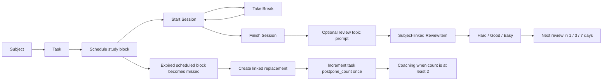
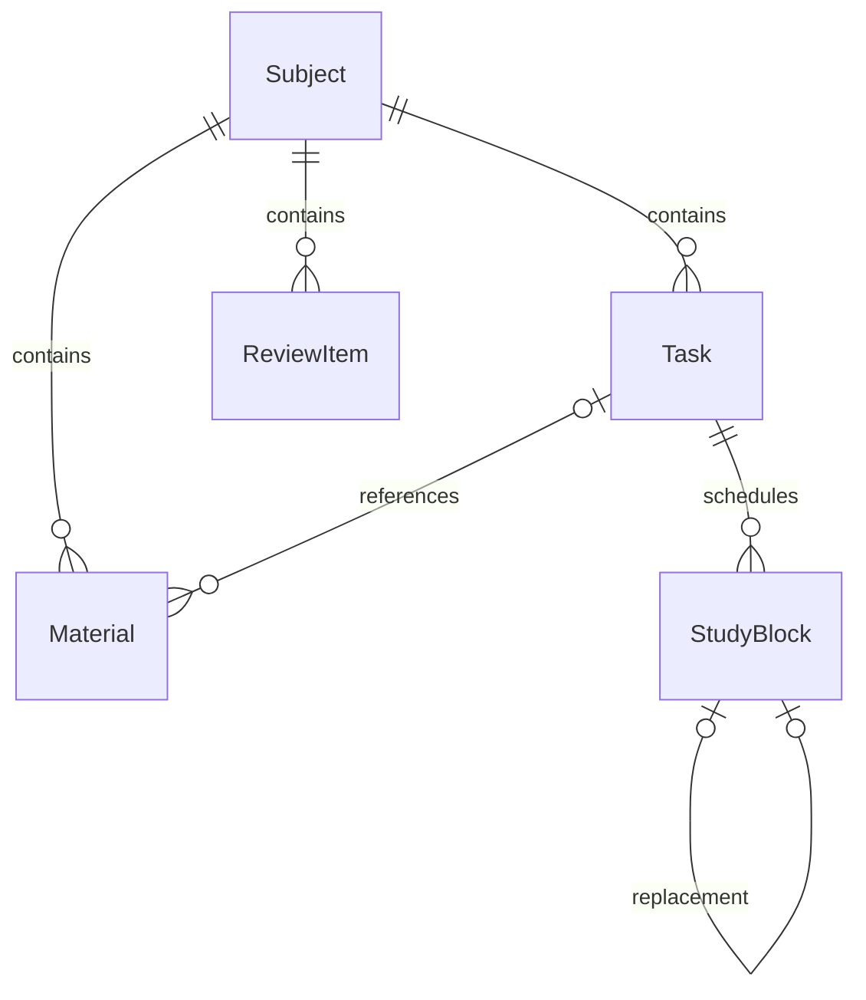

# Yotei project context

Snapshot date: **2026-10-21, Asia/Singapore**. Source baseline: Git commit `edfb6ab` (`Fallback: Working state before fixing Expo Router entry point`). Read this file with [AGENTS.md](../AGENTS.md); inspect current code and `git status` before making changes.

## Purpose and implemented scope

Yotei is a mobile study planner. Its implemented academic loop is:



All study data remains in local SQLite. Appwrite is an authentication adapter; it does not currently synchronize subjects, tasks, study blocks, or review topics.

## Stack and package policy

- Expo `~57.0.31`, React Native `0.86.3`, React `19.2.3`.
- JavaScript implementation with JSDoc types and `checkJs`; thin Expo Router routes use TSX.
- npm and `package-lock.json`; no Bun lockfile at this snapshot.
- Expo Router supplies the root stack and JavaScript bottom tabs. Ionicons come from `@expo/vector-icons`.
- Native modules used include SQLite, SecureStore, FileSystem, Sharing, DocumentPicker, safe-area context, screens, system UI, and fonts. Router animation peers are pinned to SDK-compatible versions.
- Install or change dependencies with `npx expo install`, as specified in AGENTS.md.
- The development target is the native app. Browser support is not validated end to end.

## Routing and bootstrap

1. `package.json` retains `"main": "index.js"`.
2. `index.js` imports `react-native-url-polyfill/auto` first and then `expo-router/entry`.
3. `src/app/_layout.tsx` re-exports `App.js`.
4. `App.js` mounts SafeAreaProvider, ThemeProvider, SessionProvider, themed navigation, and the protected root Stack.
5. Signed-out/restoring users see `src/app/sign-in.tsx` -> `screens/AuthScreen.js`.
6. Signed-in users see `src/app/(tabs)/_layout.tsx`, with a shared StudyWorkspace above Home, Library, Review, and Settings.
7. Tab route files re-export their screen component from `screens/`.

The original non-Router bootstrap used `registerRootComponent(App)`. That was superseded by the Router migration. Do not restore it while Router supplies the app entry.

### Additional root `app/` directory

At the start of this handoff, `app/index.tsx` was an untracked user file containing a Hello World screen. It is separate from the implemented app. The current export explicitly reports **Using src/app as the root directory for Expo Router**. Existing `tsconfig.json` includes `src/**/*.tsx`, but not the root `app/**/*.tsx` experiment.

The handoff preserves that file. If investigating a startup problem, verify the working directory, the entry chain, and Metro's selected root before moving/deleting routes or changing the architecture. A successful bundle verifies compilation, not a live navigation session on the phone.

References: [Expo custom entry setup](https://docs.expo.dev/router/installation/), [top-level src directory](https://docs.expo.dev/router/reference/src-directory/), [SDK 57 reference](https://docs.expo.dev/versions/v57.0.0/).

## File map

| Location | Responsibility |
| --- | --- |
| `App.js` | Root providers, themed navigation, protected authentication stack |
| `ThemeContext.js` | Shared palettes, AsyncStorage theme restoration/serialized saves, subject-color presentation, native appearance |
| `auth/AuthService.js` | Adapter interface and once-per-cold-boot remember-me gate |
| `auth/MockAuthService.js` | In-memory users, built-in demo account, SecureStore public session |
| `auth/AppwriteAuthService.js` | Appwrite email/password authentication and normalized users |
| `auth/index.js` | Active adapter switch and shared singleton |
| `auth/SessionContext.js` | Session restoration, sign-in acceptance, sign-out state |
| `components/StudyWorkspace.js` | Shared data/actions, mutation locks, scheduling and completion prompts |
| `hooks/useDashboardData.js` | Owned data loading, missed-block updates, due reviews, stale-request protection |
| `components/ui.js` | Themed controls, FieldLabel/InfoButton native instructional popups, and keyboard-aware Sheet |
| `components/studyStyles.js` | Shared screen/card/typography styles |
| `components/StudyCards.js` | Screen header, task/focus/coaching cards, feedback and empty states |
| `components/ScheduleSheet.js` | Selected full start/end dates, workload confirmation, schedule/reschedule calls |
| `components/DateTimeField.js` | iOS compact native pickers and Android native calendar/clock dialogs |
| `components/SubjectBookshelf.js` | Horizontal field-grouped gradient shelves, paper title labels, page/binding detail, counts/filter/reset |
| `components/EntrySheet.js` | Subject and task forms |
| `components/FocusTimer.js` | Active work/break timer, lateness, foreground ticking, pause/resume/finish actions |
| `utils/focusTimer.js` | Timestamp-derived work/break/lateness calculations and elapsed formatting |
| `components/CompletionReviewSheet.js` | Yes/no prompt and quick topic form after marking a block done |
| `components/theme.js` | Time and minute formatting helpers; palettes now live in ThemeContext |
| `db/` | SQLite schema, services, workload/date helpers, demo seed |
| `db/BackupService.js` | Versioned JSON export, native file picker/share sheet, validated transactional account restore |
| `utils/scheduling.js` | Full-date window validation, native calendar/clock edits, and default suggestions |
| `tests/database.test.cjs` | Production service SQL exercised against real Node SQLite |
| `tests/auth.test.cjs` | Both adapters exercised with isolated storage/SDK substitutes |
| `tests/backup.test.cjs` | Real SQLite restore, ID mapping, account isolation, validation, rollback, native transport substitutes |

## Authentication contract

Both adapters return exactly the public user shape `{ id: string, name: string, email: string }`. UI and database services use `user.id`, not Appwrite's raw `$id`.

```javascript
signUp({ name, email, password, rememberMe = false })
signIn({ email, password, rememberMe = false })
signOut()
getCurrentUser()
```

- `USE_REAL_AUTH` is currently `true` for real Appwrite login diagnostics. Set it to `false` and fully reload for Mock auth and the demo loader; those accounts are independent of Appwrite.
- Demo credentials: `student@yotei.demo` / `study12345`; stable demo user ID: `demo-student`.
- Mock passwords/accounts are in memory. SecureStore stores the public mock session and a provider-specific remember-me flag.
- Remember me defaults to false. A session remains usable during that launch; a false/missing/invalid flag causes cleanup on the next cold boot.
- A true flag permits session restoration. Sign-out disarms remembering and clears the provider session.
- Startup cleanup runs once per adapter instance and shares concurrent initialization calls. Failures block restoration and remain retryable.
- New mock credentials disappear on restart. A remembered public session can restore without reconstructing the mock password map; after signing out, a custom mock account may need to be created again. The built-in demo credentials remain available.
- Appwrite setup is lazy so Mock mode does not contact Appwrite. `appwriteConfig.js` now contains populated public client configuration; this differs from the initial placeholder request. No server API key belongs in that file.
- Real Appwrite behavior is covered by adapter tests with an SDK substitute; live backend/platform configuration is not revalidated by this handoff.
- The real adapter trims/normalizes email in both auth methods and validates/cleans the configured endpoint/project/platform before initializing one lazy Client. It logs the public target configuration and exact failure `{code, message, type}` for signIn/signUp, then rethrows the original error to the UI. Registration awaits its automatic login so a later login failure is also logged. Passwords/session payloads are not logged.
- A read-only request to the configured Singapore `/v1/account` endpoint using the configured project ID returned `401 general_unauthorized_scope` for a guest on 2026-10-21. This verifies API reachability and that the request reached the guest account permission check; it does not verify a user's credentials, dashboard project selection, or native platform registration.

## SQLite schema and ownership

Database: `yotei.db`. Initialization enables WAL and foreign keys, creates indexes, and exposes one shared connection only after initialization finishes. Failed initialization can retry.

| Table | Columns |
| --- | --- |
| Subject | `id`, `user_id`, `name`, `subject_code`, `field_of_study`, `field_colors` |
| Task | `id`, `user_id`, `subject_id`, `title`, `deadline`, `estimated_minutes`, `status`, `postpone_count` |
| StudyBlock | `id`, `task_id`, `start_time`, `end_time`, `status`, `rescheduled_from`, `actual_start_time`, `break_time_minutes`, `break_started_at`, `break_time_ms`, `actual_end_time`, `actual_study_seconds` |
| ReviewItem | `id`, `subject_id`, `topic`, `last_reviewed_at`, `next_review_at` |
| Material | `id`, `subject_id`, nullable `task_id`, `title`, `url_or_note`, `local_file_path` |

IDs are SQLite integer IDs; authentication IDs are strings. Subject and Task have explicit `user_id` columns. Blocks inherit ownership through Task; ReviewItem and Material inherit it through Subject. Services scope reads and writes to the signed-in account with bound SQL values.



- Task uses the composite `(subject_id, user_id)` foreign key to prevent linking another user's subject.
- Subject deletion cascades through its related tables; Task deletion cascades blocks and clears Material.task_id.
- Task cards offer Edit and Delete. `updateTask` validates the account, task ID, title and owned target subject, then changes only title/subject_id using a bound owned UPDATE. IDs, deadlines, estimated_minutes, status, postpone_count, and linked blocks are preserved. Block titles/subject labels follow the edited task; existing subject-level review topics/materials keep their subject. `deleteTask` uses one owned DELETE, cascades all block history, and leaves materials as subject notes with task_id null. Native Cancel/Delete confirmation prevents duplicate submissions and competing actions; failure unlocks retry, success refreshes all tabs.
- `deleteSubject` validates the account and integer ID and executes one owned DELETE. Foreign keys atomically remove its tasks, blocks (including replacement history), review items and materials. Missing/unowned IDs reject; a cascade failure rolls back the statement. The edit sheet offers a red Delete Subject action with native Cancel/Delete confirmation. Confirmation locks competing save/delete actions; success closes the sheet and refreshes shared tab data. Library clears a filter whose subject no longer exists; cancel/dismiss preserves the draft, and failure leaves the editor available to retry.
- `rescheduled_from` references the original block; a unique partial index permits one direct replacement for each original.
- Initialization adds `rescheduled_from` for older databases, converts legacy `planned` status to `scheduled`, installs the postponement trigger, and backfills counts without reducing existing demo/coaching values.
- Subject migration adds the two field columns, copies legacy `color` into `field_colors`, assigns existing subjects to `General`, then drops `color` in the initialization transaction. IDs, ownership and dependent records are preserved. A `(user_id, field_of_study, id)` index supports field access.
- Subject-code migration adds a non-null TEXT column with default GEN-101 in the retryable schema transaction, preserving IDs/dependencies. Codes normalize to uppercase, allow 1?32 letters/numbers plus spaces, dots, slashes, underscores and hyphens, and need not be unique. Omitted codes default on creation; older update callers preserve the existing code. Add/Edit Subject prefills the code; demo subjects use MATH-2, BIO-101 and HIST-101.
- Material has schema support only; there is no material-management UI/service yet.

## Service entry points

| Module | Public functions / values |
| --- | --- |
| SubjectService | `createSubject(userId, {name, subject_code?, field_of_study?, field_colors?})`, `updateSubject(userId, subjectId, {name, subject_code?, field_of_study, field_colors})`, `deleteSubject(userId, subjectId)`, `getSubjectsForUser(userId)` |
| TaskService | `createTask(userId, {subject_id, title, deadline?, estimated_minutes?})`, `updateTask(userId, taskId, {title, subject_id})`, `deleteTask(userId, taskId)`, `getTasksForUser(userId, {date?, hasDeadline?})`, `getTasksWithDeadlines`, `getTasksForDate` |
| StudyBlockService | `createStudyBlock`, `getStudyBlocksForUser`, `getMissedBlocksForUser`, `markExpiredStudyBlocks`, `updateStudyBlockStatus`, `rescheduleStudyBlock`, `startStudyBlock`, `pauseStudyBlock`, `resumeStudyBlock`, `finishStudyBlock` |
| StudyLoadService | `DAILY_STUDY_LIMIT = 240`, `StudyLoadWarning`, `getDailyStudyMinutes`, `checkStudyLoad` |
| ReviewService | `REVIEW_INTERVAL_DAYS`, `createReviewItem`, `getDueReviews`, `markReviewed` |
| seedData | `seedDemoData(userId)` |
| dateUtils | `getLocalDateKey`, `getLocalDayRange` |
| utils/scheduling | `buildStudyTimes({start: Date, end: Date}, now)`, `getInitialStudyWindow(now, initialDuration)`, `updateStudyWindow(window, field, part, pickedDate)` |

Subjects and tasks support create/read/update/delete; other services expose their feature-specific creation/query/status operations.

Task list queries also return `has_missed_session` (an unresolved missed block exists) and `latest_scheduled_start` (the latest scheduled start across all dates). Library shows Missed Session only when the former is true and the latter is not later than the shared clock. Summaries come from owned SQLite task queries rather than Home's day-filtered block array, so next-week scheduling hides the badge too. Missed history, Home recovery cards, and postponement coaching remain unchanged. The summary fields are derived rather than stored or backed up.

## Scheduling, workload, and recommitment

- The scheduling sheet uses `@react-native-community/datetimepicker` 9.1.0 for full Start/End dates and times. Android uses imperative native calendar/clock dialogs; iOS uses compact native controls. There is no Today/Tomorrow toggle or upper calendar-date restriction. Optional Duration input accepts 4h 30m / 45m / 2h or bare whole minutes. parseStudyDuration returns positive whole minutes; applyStudyDuration adds elapsed minutes to Start without mutating the source. Invalid drafts retain the prior dates and block Save, including keyboard submission. Changing Start preserves duration; manually editing End clears the shortcut. Clearing Duration retains the selected End. Overnight/DST windows and frozen workload confirmations keep the existing rules. SQLite derives elapsed minutes from the saved instants.
- The initial window begins at the next whole minute and uses the existing suggested length (normally 30 minutes, 5 minutes for coaching, or the missed block's length). Both endpoints are editable; this is distinct from the task's non-editable `estimated_minutes` field, which is no longer displayed on task cards.
- State stores actual Date objects, not relative day strings. A start is rejected only when its selected timestamp is earlier than now; the end must be later than the start. At 4 PM today, 5 PM today is valid; 8 AM tomorrow and next-week dates are valid too. Display strings are never parsed back as dates, and keeping the sheet open across midnight does not move its selected dates.
- Native clock edits preserve the selected calendar; native calendar edits preserve local hours/minutes and reject nonexistent local times. Moving Start shifts End by the currently selected duration. Editing End is independent. Native repeated-hour instants keep their original UTC offset. Workload confirmation revalidates its frozen instants against now before writing, so an expired start cannot be saved after waiting in the warning view.
- Store instants as ISO timestamps; calendar/date-only task deadlines remain date keys where appropriate.
- Task date queries can include tasks due on a date or with a block overlapping that local date.
- Workload includes planned minutes for `scheduled`, `active`, and `done` blocks; missed history is excluded. Cross-midnight blocks contribute only their overlap with each local day. Actual focused time is stored separately and does not replace this planning guardrail.
- A proposed total strictly greater than 240 minutes raises StudyLoadWarning. Exactly 240 is permitted. The user may explicitly confirm the warning; no block is inserted before confirmation.
- Scheduling writes are serialized so simultaneous submissions cannot both check an outdated workload total.
- Expired blocks with status `scheduled` are changed to `missed` on data refresh. Workspace checks every 30 seconds and on foreground activation, subject to mutation/modal locks; this is not an OS background notification service.
- Older unresolved misses remain visible so they can be rescheduled after midnight.
- Rescheduling preserves the missed record and creates a replacement with `rescheduled_from = original.id`. Repeated submissions return the existing replacement.
- The database trigger `count_study_block_postponement` increments Task.postpone_count on replacement insertion. **Do not add a second increment in the UI or service.** A retry must not increase the count again.
- The service's no-options reschedule default is one hour from the supplied reference time. The current UI supplies the user's selected start/end instants instead.
- The shared data refresh after saving exposes the new task count immediately. Coaching appears when `postpone_count >= 2`, with an action to schedule 5 minutes.

## Commitment Focus Timer

- A scheduled block displays Start Session during its scheduled window. `startStudyBlock(userId, blockId)` stamps actual_start_time and changes status to `active`. Future/expired/missed/resolved blocks cannot start; reschedule a miss first. At most one active block is allowed per account, including while on break. Different accounts remain isolated.
- An active block replaces the normal card with FocusTimer, sorted first in Home. It shows work elapsed, lateness (including starts less than one minute late), total breaks, and Take Break/Finish Session. During a break it shows current break elapsed, frozen work time, Resume Work, and Finish Session.
- `break_started_at` identifies an open break while status remains active. `break_time_ms` preserves exact completed break durations; `break_time_minutes` is their floored whole-minute projection, updated on resume/finish. `actual_end_time` and `actual_study_seconds` freeze the result on finish. Required fields and auxiliary timing fields migrate in place with null/zero defaults; historical done blocks receive no invented actual study time.
- Finish closes an open break, subtracts all break milliseconds from actual wall-clock duration, floors once to whole studied seconds, and marks done. Scheduled start/end times remain unchanged. Completed timer cards show actual studied time and break minutes.
- Start/pause/resume/finish serialize with scheduling writes and use exclusive transactions. Retrying a transition does not restart the clock or add a break twice. Ownership, state and backwards-clock checks run before committing; failure leaves stored timing intact. No fallible read follows a committed transition.
- Work/break timing derives from stored timestamps, not tick counts. The view ticks once per second only while Home is focused and the app is active, then catches up on foreground. Backgrounding, changing tabs, signing out or restarting does not implicitly pause: the selected work/break mode continues until changed. This does not require background JS or an OS timer service.
- Active blocks are excluded from automatic missed detection and remain in Home's date-filtered query even after midnight or the scheduled end, so users can resume/finish them. Expired unstarted scheduled blocks still become missed normally.

## Completion-to-review flow

1. Home's Finish Session action calls `finishStudyBlock(user.id, id)`, persisting actual timing and done status together. The legacy `updateStudyBlockStatus` service remains available for untimed scheduled-block status operations.
2. The returned block includes `subject_id`, `subject_name`, and `task_title` from the owned Task/Subject join.
3. StudyWorkspace opens CompletionReviewSheet with the exact requested question about adding a topic to the Review Queue.
4. No/Skip leaves the block done and creates no review item.
5. Yes reveals a topic field. Saving calls `createReviewItem` with the completed block's subject ID and refreshes shared data.
6. The new review is immediately due. A failed save retains the entered topic and permits retry or skip.

Completion is independent from accepting the review prompt. Do not revert a completed block merely because the user skips or topic creation fails.

`createReviewItem` reads/validates the subject before its scoped insert and returns a composed normalized object. It intentionally avoids a fallible lookup after insertion, which could report an inserted topic as unsaved and invite duplicate creation on retry.

ReviewItem links to a Subject, not directly to a Task or StudyBlock. Do not assume additional foreign keys exist.

## Spaced repetition

- A new ReviewItem has null review timestamps and is immediately due.
- `getDueReviews(userId)` returns owned items with `next_review_at IS NULL` or a timestamp at/before now.
- `markReviewed(userId, reviewId, difficulty)` updates last_reviewed_at and advances local calendar days, preserving the local review time through daylight-saving transitions.
- Hard = 1 day; Good = 3 days; Easy = 7 days. These are fixed intervals per rating, not an SM-2 or adaptive interval algorithm.
- The Review UI shows only Hard/Good/Easy rating buttons, with no interval labels, interval guidance popup, or interval announcements. Success feedback is simply "Review saved." The underlying intervals are unchanged.
- Rated items leave the due queue until their scheduled time. An atomic due-condition guard prevents two taps from rating the same occurrence twice.
- Review refreshes on tab focus, once per minute while focused, and through shared foreground/day refreshes. Background refreshes do not disable a topic field while the user is typing.

## Demo seed

`seedDemoData(userId)` uses an exclusive transaction to clear that user's Material, ReviewItem, StudyBlock, Task, and Subject records and replace them with:

- Mathematics, Biology, History.
- Six tasks: tomorrow/today/overdue deadlines; two tasks have postpone_count 2 so coaching is visible.
- Four 60-minute study blocks with 10-minute gaps, all inside today's local calendar day. Their total study duration is exactly 240 minutes, including near midnight and DST days.
- Elapsed seeded sessions are `done`; current/future ones are `scheduled`. This prevents the automatic missed check from reducing the intended demonstration workload immediately after loading.
- Three due topics, one under each subject: quadratic equations, mitosis, and causes of the French Revolution.

The seed returns `{ subjects: 3, tasks: 6, studyBlocks: 4, reviewItems: 3, totalMinutes: 240 }`. It preserves authentication and other accounts' records; rollback restores prior study records if an insert fails.

## Study data export/import

Settings > Data Management is available with both authentication adapters. `exportBackup(userId)` reads all five owned collections in one exclusive transaction, writes formatted version-4 JSON with SDK 57's `File`/`Paths` APIs, and opens the native share sheet. Subjects contain subject_code and field metadata; StudyBlocks include all timer columns. Versions 1?3 import with GEN-101 codes. Only versions 1/2 receive empty timer defaults; version-3 timer metadata is preserved; version-1 colors become single-color fields under General. Timer state, totals and the single-active-session rule are validated before replacement. Active/open-break timestamps and completed actual totals survive restoration. Successful exports remain in cache for receiving applications; the user must save/share a copy through that sheet.

`importBackup(userId)` opens a single-file JSON picker with `copyToCacheDirectory: true`. Cancel returns null. Format/version, collections, field types, dates, unique IDs, foreign references, time ranges, and rescheduling history/counts are validated before any deletion. A 20 MB file limit bounds parsing on mobile.

Restore uses an exclusive transaction, replaces only the destination account's five collections, allocates fresh local IDs, and remaps every relationship. Source ownership metadata is not used. StudyBlock history links are attached by UPDATE after insertion to avoid the postponement INSERT trigger; historical counts remain intact and new reschedules still increment once. Any database failure rolls back deletion and partial inserts together.

StudyWorkspace blocks concurrent mutations/sign-out while the picker/share/restore is open. A successful import refreshes all tab data and increments the existing `demoRevision` reset signal, also clearing stale Library subject filters and Review form selections/drafts. The normal refresh can mark restored expired scheduled blocks as missed. Import keeps the user in Settings and reports record counts.

The JSON contains study records only: no passwords, sessions, theme preference, or attachment bytes. Material notes, URLs, and local paths are preserved; a path from another device may no longer resolve. Backups are manual file transfers, separate from the source/history handoff archive and from cloud sync. Native Android/iOS are supported; web receives an explicit unsupported message. See [DATA_BACKUP.md](DATA_BACKUP.md) for the format, complete file changelog, and test procedure.

## UI constraints that remain in force

- Keep functional text; the early marketing/editorial slogans were removed.
- Home displays **By students, for students.** in a small, subtle footer after the study list or empty state. Settings has no motto footer.
- Retain the four Ionicons tabs, subtle tab top border, cards, visible input backgrounds/borders, and full-width primary actions.
- Shared screen horizontal padding is 20px. Standard cards use 20px internal padding, 16px radius, a 1px border, and 24px separation. Section/action/form spacing increased by roughly 8–12px in the UX pass.
- Dark: `#0C1117` background, `#151D27` cards, `#293442` borders, purple accent.
- Light: `#F5F5F5` background, `#FFFFFF` cards, `#E0E0E0` borders, black text/accent and white primary-button text. Bookshelf spines and explicit field-color swatches are the scoped color exceptions; task/review markers and selectors stay monochrome.
- Library groups subjects by normalized field name (case-insensitive) into horizontally scrolling shelves. Closed books are narrow one/two-color gradient spines showing only subject_code rotated 90 degrees, with binding rules and page edges. Tapping a spine reveals one front cover without filtering, using standard Animated width/tilt/lift over 260ms; reduced motion snaps directly. The cover shows full name, code, task count, return-to-shelf and separate Edit controls. Tap the cover body to filter (or deselect), with an outline/checkmark/Selected label. Long/scaled titles wrap at natural height. Return preserves the filter; **Show All Tasks** resets filtering and closes the cover. Both themes retain book colors. The pencil opens the existing EntrySheet prefilled for editing. Save updates the owned row in place and refreshes all shared tab data, preserving its ID and task filter selection; changing field moves the book to its new shelf. Existing non-palette colors remain selectable in the editor. Cancel leaves storage unchanged; save errors retain the draft. Demo/import revisions clear selection.
- Add Subject requires a name and Field of Study, including combined labels like `Biology, Chemistry`. Choose one or two distinct colors from twelve named swatches in either theme, including pure Black/White. Each swatch has a fixed-size colored circle with a gray outline so both extremes remain visible. `utils/subjectFields.js` trims comma-separated labels, validates lengths/hex colors, and supplies a subtle single-color highlight. Services default omitted fields to General / Iris; UI requires explicit field text. Task/block/review results retain `subject_color` as the first stored color for existing marker consumers.
- Theme is stored under AsyncStorage key `yotei.theme` as `dark` or `light`, device-wide and independent of sign-out. The provider waits for restoration before mounting screens, defaults to dark for missing/invalid/unreadable values, serializes rapid writes, and logs storage failures without blocking the current UI. Theme preferences are excluded from study backups.
- Settings labels the current appearance Dark Mode or Light Mode. Light mode uses a black enabled switch track, gray disabled track, and white thumb; the web-specific active-thumb override prevents React Native Web's default green thumb.
- General instructional paragraphs across screen headings, auth/study forms, and cards are behind small information icons. `FieldLabel` accepts `help`; `InfoButton` opens a brief native Alert with the selected theme. Errors, workload totals/confirmation, import-overwrite warning, demo replacement notice, decision prompts, and the Home motto remain directly visible.
- Keep inputs within keyboard-aware layouts. AuthScreen and inline Review use KeyboardAvoidingView. The shared Sheet places KeyboardAvoidingView at the full native Modal viewport, with a shrinking scroll area, scrollable header, and safe-area handling. Shared Input reports focus to Sheet; after focus, keyboard-show, or layout changes, Sheet measures input and scroll viewport in window coordinates and scrolls the field into view. EntrySheet, ScheduleSheet, and CompletionReviewSheet all inherit this behavior.

## Known boundaries and next-session checks

- Physical-device keyboard/modal/tab appearance and accessibility interaction are not covered by Node tests or bundle export.
- The local root `app/index.tsx` experiment is not part of the active route tree or current TypeScript include set. Preserve it until a specific routing change is authorized.
- Appwrite client configuration is populated and real auth is active. Tests use an SDK substitute; the guest API probe does not prove live account/session behavior.
- `deadline` and `estimated_minutes` are service/schema fields; the current task creation form primarily exposes title and subject.
- Review topics have no edit/delete screen; Material has no user flow; study data has no cloud sync or scheduled background notifications.
- There is no `eas.json` in this snapshot, and no store-release validation has been performed.
- Browser study storage is intentionally disabled. App.js checks Platform.OS before mounting sessions/routes and shows a themed mobile-only notice. Metro resolves db/database.web.js instead of database.js, excluding SQLite/WASM from web builds; its storage API rejects explicitly. Native database migrations and study services are unchanged. Full web study support would need a separate implementation.
- Native generated `ios/` and `android/` directories are absent/ignored; configure native behavior through app config/plugins per AGENTS.md.

See [VALIDATION.md](VALIDATION.md) for the dated evidence and [NEXT_SESSION_PROMPT.md](NEXT_SESSION_PROMPT.md) for a concise handoff.
